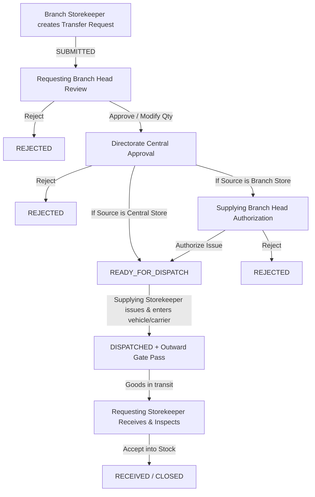

# CSMS V2 — Stock Transfer Module User Operations Manual

**Document Version:** 2.0  
**Target Audience:** General Storekeepers, Branch Storekeepers, Branch Heads, Deputy Superintendent (Stock & Stores), Directorate Officers, and System Administrators.  
**Applicability:** Central Store Management System (CSMS V2).

---

## 1. Executive Summary & Purpose

The **Stock Transfer Module** manages the movement of inventory across different physical store locations within the organization. In CSMS V2, transfers can occur between:
1. **Central Store (Directorate) $\leftrightarrow$ Branch Store** (e.g., Central Store to Central Press Store, or branch returning stock to Central Store).
2. **Branch Store $\leftrightarrow$ Branch Store** (e.g., lateral replenishment or stock redistribution between regional branches).

Stock transfers operate in two distinct modes:
- **`PULL` (Branch-Initiated Request):** Raised bottom-up by a Storekeeper requiring stock, vetted by their Branch Head, approved by Directorate, and authorized by the supplying store.
- **`PUSH` (Directorate Directive):** Ordered top-down by Directorate executive authority to allocate, balance, or redistribute inventory across departmental stores.

---

## 2. Core Architectural & Accounting Principles

Under [AGENTS.md](file:///f:/project/central_store_V2/AGENTS.md):
- **Store-Centric Ownership:** Stock belongs strictly to a physical **Store**, not an Office, Section, or individual User.
- **Stock Movement Authoritative Ledger:** Stock balances are server-computed from immutable `StockMovement` transactions. Balances are **never** updated directly.
- **Financial Year & Item Identity:** Consumable stock identity is `Store + Financial Year + Item`.
- **Timing of Ledger Impact:**
  - **Stock OUT (`TRANSFER_OUT`):** Deducted from the supplying store **only upon physical dispatch**.
  - **Stock IN (`TRANSFER_IN`):** Credited to the receiving store **only upon physical inspection and acceptance**.
  - **In-Transit Protection:** While goods are in transit, they are not available for requisition or issue at either store.
- **Zero & Partial Fulfilment:** Partial issues or partial receipts are valid and recorded with full auditability.
- **Outward Gate Pass:** Dispatches generate an official, printer-friendly A4 Gate Pass containing transport details and mandatory signatures.

---

## 3. Workflow Comparison: PULL vs PUSH

| Dimension | PULL Transfer (Branch Request) | PUSH Transfer (Directorate Directive) |
| :--- | :--- | :--- |
| **Originator** | Branch Storekeeper (`dev_press_sk`) | Directorate Officer / Deputy Superintendent (`dev_deputy`) |
| **Primary Intent** | Requesting replenishment or raw materials | Strategic redistribution or mandated stock quotas |
| **Branch Head Review** | **Mandatory** by Requesting Branch Head | **Bypassed** (Directive ordered centrally) |
| **Directorate Approval** | **Mandatory** central review step | **Implicitly Approved** at creation |
| **Initial State** | `SUBMITTED` | `READY_FOR_DISPATCH` (if Central Store is source)<br>`DIRECTORATE_APPROVED` (if Branch is source) |
| **Supplying Authorization** | Required if supplying store is a Branch | Required if supplying store is a Branch |
| **Gate Pass Generation** | Generated upon physical issue by supplying storekeeper | Generated upon physical issue by supplying storekeeper |

---

## 4. Detailed Lifecycle: Branch-Initiated Request (`PULL`)



### Step 1: Raising the Transfer Request (`SUBMITTED`)
- **Actor:** Requesting Storekeeper (e.g. Branch Storekeeper).
- **Navigation:** Navigate to **Transfers** $\rightarrow$ Click **+ New Transfer**.
- **Actions:**
  1. Transfer Mode is set to **`PULL` (Pull Request)**.
  2. Select **Source (Supplying) Store** (e.g. Central Store or another Branch Store).
  3. Select **Destination (Requesting) Store** (pre-selected to the user's assigned branch store).
  4. Specify **Transfer Date** and optional justification remarks.
  5. Add one or more line items, selecting the Item and specifying the **Requested Quantity**.
  6. Click **Submit Stock Transfer**.
- **Result:** The system assigns a unique reference number (e.g., `TRF-000012`) and sets status to **`SUBMITTED`**.

### Step 2: Requesting Branch Head Review (`BRANCH_APPROVED`)
- **Actor:** Branch Head of the requesting office.
- **Navigation:** Navigate to **Transfers** $\rightarrow$ Open the transfer in status `SUBMITTED`.
- **Actions:**
  - Verify requirement legitimacy and stock necessity.
  - Optionally adjust the **Approved Quantity** per item line.
  - Enter optional review remarks.
  - Click **Approve & Forward to Directorate** (or click **Reject Transfer** with a mandatory reason).
- **Result:** Status moves to **`BRANCH_APPROVED`**.

### Step 3: Directorate Central Approval
- **Actor:** Deputy Superintendent, Stock & Stores / Directorate Officer.
- **Navigation:** Open transfer in status `BRANCH_APPROVED`.
- **Actions:**
  - Review statewide inventory, reorder thresholds, and inter-branch quotas.
  - Optionally fine-tune approved quantities.
  - Click **Grant Directorate Approval** (or **Reject Transfer**).
- **Result:**
  - If the **Source Store is Central Store**: Directorate has direct executive control over Central Store; the transfer transitions immediately to **`READY_FOR_DISPATCH`**.
  - If the **Source Store is another Branch Store**: Transitions to **`DIRECTORATE_APPROVED`**, requiring that branch head's issue authorization.

### Step 4: Supplying Branch Head Authorization (`READY_FOR_DISPATCH`)
*(Applies only when stock is sourced from a peer Branch Store)*
- **Actor:** Branch Head of the supplying branch.
- **Navigation:** Open transfer in status `DIRECTORATE_APPROVED`.
- **Actions:**
  - Review directorate approval directive and local operating needs.
  - Click **Authorize Stock Issue**.
- **Result:** Status transitions to **`READY_FOR_DISPATCH`**.

### Step 5: Physical Stock Issue & Outward Gate Pass (`DISPATCHED`)
- **Actor:** Supplying Storekeeper (General Storekeeper for Central Store, or Branch Storekeeper for Branch).
- **Navigation:** Open transfer in status `READY_FOR_DISPATCH`.
- **Actions:**
  1. The system displays current live stock availability at the supplying store.
  2. Enter **Dispatch Date**.
  3. Enter **Vehicle Number** (e.g., `KL-01-AB-1234` or `Hand Delivery`) — *Optional*.
  4. Enter **Person Receiving / Carrier** (e.g., `Driver Suresh / Department Courier`) — *Optional*.
  5. Verify or adjust the actual **Dispatch Quantity** per item.
  6. Click **Issue Stock & Generate Outward Gate Pass**.
- **Ledger Impact:**
  - Posts immutable `TRANSFER_OUT` records against the supplying store.
  - System generates printable **Outward Gate Pass (A4)** and vector **PDF**.
  - Transfer status transitions to **`DISPATCHED`**.

### Step 6: Physical Receipt & Acceptance (`RECEIVED` / `CLOSED`)
- **Actor:** Destination (Requesting) Storekeeper.
- **Navigation:** Open transfer in status `DISPATCHED`.
- **Actions:**
  1. Physically unload and inspect received cartons and materials against the Gate Pass.
  2. Enter **Receive Date** and optional remarks on packaging condition.
  3. Enter the exact **Received & Accepted Quantity** for each line.
  4. Click **Accept & Receive Stock into Store**.
- **Ledger Impact:**
  - Posts immutable `TRANSFER_IN` movements against the receiving store.
  - Status transitions to **`RECEIVED`** (or **`CLOSED`**).

---

## 5. Detailed Lifecycle: Directorate-Ordered Transfer (`PUSH`)

```mermaid
flowchart TD
    A["Directorate Officer initiates Push Directive (PUSH Mode)"] --> B{Is Source Store Central Store?}
    B -->|Yes (Central Store)| C["READY_FOR_DISPATCH (Instant)"]
    B -->|No (Branch Store)| D["DIRECTORATE_APPROVED"]
    D -->|Supplying Branch Head Authorizes| C
    C -->|Supplying Storekeeper issues stock & enters vehicle/carrier| E["DISPATCHED + Outward Gate Pass"]
    E -->|Transport in transit| F["Destination Storekeeper Inspects & Accepts"]
    F -->|Stock credited to Destination Store| G["RECEIVED / CLOSED"]
```

### Step 1: Directorate Initiates the Directive
- **Actor:** Deputy Superintendent, Stock & Stores or Directorate Admin (`STOCK_TRANSFER_APPROVE_DIRECTORATE`).
- **Navigation:** Go to **Transfers** $\rightarrow$ Click **+ New Transfer**.
- **Form Selections:**
  1. Under **Transfer Mode**, choose **Push Directive (Ordered by Directorate)**.
  2. Select the **Source (Supplying) Store** (e.g., Central Store).
  3. Select the **Destination (Receiving) Store** (any active branch store).
  4. Specify transfer date and administrative directive justification (e.g., *"Redistribution of examination answer booklets"*).
  5. Add item lines and ordered quantities.
  6. Click **Submit Stock Transfer**.
- **Result:**
  - Because Directorate has ordered the transfer, the intermediate requesting branch head review is completely bypassed.
  - **If Source is Central Store:** Immediately enters **`READY_FOR_DISPATCH`**.
  - **If Source is a Branch Store:** Enters **`DIRECTORATE_APPROVED`** to allow the supplying branch head to schedule warehouse packing.

### Step 2: Physical Issue & Gate Pass
- Handled identically to Step 5 of the Pull workflow by the supplying storekeeper.
- Optional vehicle number and carrier name are logged.
- `TRANSFER_OUT` ledger entries are atomically posted.
- Status becomes **`DISPATCHED`**.

### Step 3: Destination Store Physical Receipt
- Handled identically to Step 6 of the Pull workflow by the receiving storekeeper.
- Items are physically verified and posted as `TRANSFER_IN` into destination inventory.

---

## 6. Outward Gate Pass Specifications (A4 Format)

When any stock transfer is dispatched, the system provides an official **Outward Gate Pass**:

### Key Data Fields:
1. **Header:** Department Government Emblem, Central Store Management System, Official Outward Gate Pass title.
2. **Transfer Reference:** Unique Transfer Number (`TRF-XXXXXX`), Date, Mode (`PUSH` / `PULL`), and Financial Year.
3. **Consignor (Origin):** Supplying Store Name, Associated Office/Directorate.
4. **Consignee (Destination):** Receiving Store Name, Branch Office Name.
5. **Transport Particulars:**
   - **Vehicle Number:** e.g. `KL-01-CB-5678` (non-mandatory; displays `—` if blank).
   - **Carrier / Received By:** e.g. `K. Raman (Driver)` (non-mandatory; displays `—` if blank).
6. **Dispatched Items Table:**
   - Sl. No., Item Code, Item Description, Unit of Measurement, Dispatched Quantity, Serial/Asset Identifiers (if asset items), and Remarks.
7. **Signatory Verification Blocks (4 Columns):**
   - **Prepared By:** Supplying Storekeeper signature block.
   - **Approved / Issued By:** Controlling Officer signature block.
   - **Carrier / Driver Acknowledgment:** Signature, Name, and Date.
   - **Receiving Storekeeper:** Inspection and physical receipt acknowledgment.

### Accessing & Printing the Gate Pass:
- **Web View:** Open transfer $\rightarrow$ Click **Outward Gate Pass (A4)** button (`/app/transfers/{id}/gate-pass`).
- **Print Directly:** Click browser **Print** (pre-calibrated for standard A4 portrait without web margins or buttons).
- **Edit Details:** Click **Edit Vehicle / Carrier** to update vehicle or recipient details post-dispatch.
- **PDF Export:** Click **Download PDF** for an instant vector PDF document (`/app/transfers/{id}/gate-pass.pdf`).

---

## 7. Role & Permission Matrix

| Role | Can Initiate PULL | Can Initiate PUSH | Can Approve Branch | Can Approve Directorate | Can Authorize Supply | Can Dispatch | Can Receive |
| :--- | :---: | :---: | :---: | :---: | :---: | :---: | :---: |
| **Branch Storekeeper** | Yes | No | No | No | No | Yes (assigned) | Yes (assigned) |
| **General / Assistant Storekeeper** | Yes | No | No | No | No | Yes (Central) | Yes (Central) |
| **Branch Head** | No | No | Yes (own branch) | No | Yes (own branch) | No | No |
| **Deputy Superintendent** | Yes | Yes | No | Yes | No | No | No |
| **Directorate / System Admin** | Yes | Yes | Yes | Yes | Yes | Yes | Yes |

---

## 8. Common Troubleshooting & FAQs

1. **Why can't I select the same Source and Destination Store?**
   - A store transfer requires distinct supplying and receiving stores. Intra-store adjustments are handled under Store Verification & Adjustment.
2. **Are vehicle number and receiver name mandatory?**
   - No. Both are optional to allow for hand delivery, internal messenger, or delayed carrier assignments.
3. **Can approved quantities be reduced during review?**
   - Yes. Branch Heads and Directorate officers can lower approved quantities on any line before granting approval.
4. **What happens if an item is damaged or short during transit?**
   - The destination storekeeper enters the actual physical quantity received. The remaining quantity is closed with audit notes, preventing phantom stock.
